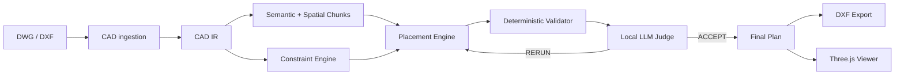

# GreenPlan — automatic urban greening placement from CAD drawings

> **Документация для экспертов (на русском): [docs/DOCUMENTATION.md](docs/DOCUMENTATION.md)** —
> назначение, архитектура, алгоритм, интерпретируемость, схема процесса BPMN
> ([docs/bpmn/](docs/bpmn/)), инструкция по запуску и проверке, ограничения.

GreenPlan takes a site plan (**DWG / DXF**), understands what is on it (buildings,
roads, sidewalks, utilities, existing vegetation), builds **regulatory exclusion
zones**, computes the **allowed planting area**, and generates an **optimized,
explainable, deterministic** tree/shrub placement plan. The result is reviewed by
a **local LLM judge** (soft quality only), can be re-run with safe parameter
adjustments, and is exported as a **valid DXF** that preserves the original
drawing and adds `AI_GREENING_*` layers — plus a full JSON provenance report.

The Three.js viewer is the primary interface: original CAD geometry, zone
overlays, candidates and placements are all rendered interactively, and every
generated tree can be clicked to see exactly *why it is allowed to stand there*.

## Product

Landscape engineers spend days manually checking planting positions against
normative distance rules (СП 42.13330, ТСН 30-307-2002, ППМ №743-ПП, …) on CAD
plans. GreenPlan automates the geometric part of that workflow:

1. CAD ingestion (DWG→DXF via external converter, DXF via ezdxf) → precise IR.
2. Semantic classification of layers (deterministic keywords → geometry
   heuristics → optional local LLM), always with confidence and user override.
3. A **data-driven regulatory rule registry** produces exclusion buffers with
   full provenance (rule → document → clause → status).
4. Deterministic candidate generation (seeded Poisson-disc) + optimizer
   (greedy + local search, 4 strategies) inside the allowed area.
5. A deterministic validator is the **final authority** on compliance.
6. A local LLM judges *soft* quality (distribution, clustering, coverage) and
   may request a bounded, parameter-safe rerun (max 3 iterations).
7. Export: `<name>_greening.dxf` (original entities preserved, result layers
   added, XDATA metadata per tree) + `<name>_greening_report.json`.

## Architecture



**Two representations, one source of truth.** The precise CAD IR (meters,
Shapely geometry) drives all regulatory math and DXF export. A compact
semantic/chunk digest — never raw CAD — is the only thing an LLM sees.

**Hard vs soft.** A hard-rule violation invalidates a candidate; it is never
converted into a score penalty. The LLM cannot mark a plan valid when the
deterministic validator reports hard violations — this is enforced in code
(`judge.py`), not by prompt.

```text
monorepo
├── apps/api          FastAPI backend (Python 3.11, ezdxf, Shapely, NumPy)
│   ├── app/services  parser, converter, classification, chunking, rules,
│   │                 constraints, candidates, optimizer, validator,
│   │                 explain, judge, llm, dxf_export
│   └── tests         33 unit/integration/round-trip tests
├── apps/web          React 18 + TypeScript + Tailwind + three.js viewer
├── rules             regulations.yaml (rule registry), species.yaml
├── fixtures          synthetic_site.dxf (deterministic test fixture),
│                     site_plan_real.dwg (real integration fixture),
│                     normative_acts_registry.pdf (source registry)
├── docs/API_CONTRACT.md
└── outputs           exported DXF / reports
```

## Setup

### Docker (one command)

```bash
docker compose up --build
# web: http://localhost:5173   api: http://localhost:8000
```

The API image compiles LibreDWG and downloads ODA File Converter from the Open
Design Alliance at build time, so DWG upload works out of the box (without
internet access to ODA the build goes on with LibreDWG only).
Point `LOCAL_LLM_BASE_URL` at a host-side LLM runtime (see below).

### Local development

```bash
make install     # pip deps + npm install
make fixture     # regenerate fixtures/synthetic_site.dxf
make dev         # api :8000 + vite :5173 (or run `make api` / `make web`)
make test        # pytest suite
make e2e IN="object.zip"   # end-to-end run through the running API, results checked
```

`make e2e` uploads each drawing or xref package, generates, and checks every
result against invariants (no violations, plantings inside the allowed area,
every check sourced, AutoCAD-safe DXF) and against the golden metrics in
`apps/api/tests/golden/e2e/`; pictures and a summary land in
`outputs/e2e/index.html`. Checked results of the pilot objects are in
[`examples/`](examples/README.md).

Requirements: Python ≥3.11, Node ≥20. Copy `.env.example` → `.env` as needed.

## DWG support

DWG is a proprietary binary format; GreenPlan integrates **external converters**
through `DwgConverter` (no proprietary binaries bundled in this repository).
The Docker image builds LibreDWG and downloads ODA File Converter — freeware of
the Open Design Alliance without a redistribution grant — from ODA itself
(`--build-arg WITH_ODA=0` skips it); ODA runs under `xvfb-run`, and a file ODA
fails on falls back to LibreDWG:

| Converter | Config |
|---|---|
| ODA File Converter | `ODA_FILE_CONVERTER_PATH=/path/to/ODAFileConverter` |
| LibreDWG `dwg2dxf` | `LIBREDWG_DWG2DXF_PATH=/path/to/dwg2dxf` |

`DWG_CONVERTER=auto` (default) picks whichever is available (ODA preferred).
Without a converter, DXF continues to work and DWG upload returns a structured
`DWG_CONVERTER_UNAVAILABLE` error which the UI explains. Conversion runs as a
sandboxed subprocess (argv list, timeout, no shell interpolation).

The provided real drawing (`fixtures/site_plan_real.dwg`, AC1032, 12 824
entities) is used as an integration fixture: with a converter present,
`pytest` runs conversion → parsing → classification on it.

## Local LLM

The judge/classifier uses **only a local OpenAI-compatible endpoint** — no
cloud APIs, by design. Any of these work:

```bash
# Ollama
ollama serve                     # LOCAL_LLM_BASE_URL=http://localhost:11434
ollama pull qwen2.5:3b           # LOCAL_LLM_MODEL=qwen2.5:3b

# llama.cpp
llama-server -m model.gguf --port 8080    # LOCAL_LLM_BASE_URL=http://localhost:8080

# vLLM
vllm serve Qwen/Qwen2.5-3B-Instruct       # LOCAL_LLM_BASE_URL=http://localhost:8000
```

`LOCAL_LLM_MODEL` may be left empty — the first model reported by
`/v1/models` is used. Structured output uses grammar-constrained
`response_format: json_schema` when the runtime supports it, falling back to
`json_object` and then plain prompting, always validated by Pydantic.

**If no LLM is reachable, the pipeline does not break**: the judge switches to
a clearly-labeled deterministic heuristic (`mode: "heuristic_fallback"` in every
report and in the UI). Bigger models produce meaningfully better judge
reasoning; a 0.5B model works but writes wobbly prose.

## Regulatory system

Rules are **data** (`rules/regulations.yaml`), not code. Each rule carries:
id, applicability (planting type × obstacle type), machine-readable constraint,
source document + date + clause + URL + excerpt, severity, verification status.

> **Rules with `status: missing_source_data` are not considered verified
> regulatory constraints and are not silently enforced.**

The provided registry PDF lists the applicable documents but **not** their
numeric clause values. Per project policy, no regulatory number was invented:

* every distance rule ships with `constraint.distance_m: null` and
  `status: missing_source_data`;
* a separate `assumption` block holds an explicitly-flagged, user-configurable
  **demo value** (`ДЕМО-значение`), enforced only while enabled and labeled
  **ASSUMED** (amber) everywhere — UI, API (`effectiveSource`), report and
  per-tree explanations. Verified values would be labeled **VERIFIED** (green);
* to verify a rule: paste the clause value into `constraint.distance_m`, add
  `source.clause` / `source.excerpt`, set `status: verified`. No code changes.
* the invasive-species rule (ППМ № 369-ПП) is architecturally ready: the moment
  a verified species list is added to `constraint.species`, those species are
  automatically rejected. The list itself is absent from source data and was
  **not** invented — the rule shows up as inactive with an explanation.

Documents registered: ППМ № 743-ПП (10.09.2002), ППМ № 515-ПП (08.08.2017),
ППМ № 369-ПП (03.03.2026), Закон г. Москвы № 18 (30.04.2014), СП 82.13330.2016,
СП 42.13330.2016, СП 59.13330, ППМ № 623-ПП, ТСН 30-307-2002 (МГСН 1.02-02),
ГОСТ 21.508-2020.

## Reproducibility & observability

Every iteration stores: algorithm parameters, per-iteration random seed,
placements, validation report, judge report, runtime, ruleset/parser/algorithm
versions, input file hash and LLM model. Same file + same seed + same
parameters ⇒ identical placements (covered by a test).

## Security

Uploads are untrusted: extension + magic-byte validation, size limit, random
server-side filenames, converter/parser timeouts, subprocess without shell,
no user-controlled paths in commands.


## Iteration 2 — three reasoning layers, evals, regulations ingestion

The product now separates three reasoning layers explicitly:

1. **Deterministic compliance engine** — geometry, buffers, spacing, allowed
   zones, DXF re-validation. Final authority; no LLM can override it.
2. **Local production Judge** (`prompts/judge/v*.md`, versioned) — runs ONLY on
   deterministically valid plans (hard violations are repaired deterministically
   first). Answers one question: *is another optimizer iteration likely to give a
   materially better plan?* Output is a strict schema (ACCEPT / RERUN /
   MANUAL_REVIEW) with evidence IDs referencing packet diagnostics (quadrants,
   clusters, underused zones); parameter changes are whitelist+range+max-delta
   clamped in code. No LLM-invented quality scores — UI numbers come from
   deterministic components.
3. **Offline eval LLM** (`evals/`) — dev/CI only, and **local open-source by
   default**: a second llama.cpp instance on the server (port 8081) serving
   Qwen2.5-7B-Instruct, deliberately stronger than the production judge model.
   The protocol is OpenAI-compatible (`OPENAI_BASE_URL`, `OPENAI_EVAL_MODEL`);
   an unreachable endpoint or absent model raises an explicit capability error —
   no silent fallback, no implicit choice between several served models.
   Pairwise A/B comparisons run both orders; disagreement ⇒ INCONCLUSIVE.

**Evals** (`make eval`): 10-case golden dataset (generated deterministically),
241 Level-A checks incl. export→re-parse→re-validate hard constraints, judge
benchmark (mock + live modes), results in `eval-results/<ts>/results.json`.

**Regulations** (`/api/regulations` + REGULATIONS view): upload PDF/DOCX →
hierarchy with stable fragment ids → LLM rule candidates with exact provenance →
deterministic numeric-literal gate (value+unit must appear in the source
fragment) → second-pass verifier → human review → VERIFIED→ACTIVE rules merge
into the constraint engine as `REG_*` with full citations. Documents are data:
prompt-injection cannot alter statuses. Extraction benchmark:
`python3 evals/regulations/score.py --mock`.

**Progressive disclosure UI**: near-blank empty state → semantic layer groups
(raw CAD layers one click deeper) → single review interrupt for uncertain
layers → overlay legend instead of rule tables → Generate with Advanced
settings collapsed → post-generation Quality review card → PLAN / REGULATIONS /
RUNS / QUALITY navigation. Debug info behind `?debug=1`.
Playwright specs: `tests/playwright/` (run with `PW_BASE_URL=... npx playwright test`;
executed on the deployment host — screenshots at 1366/1440/1920).

## Limitations (explicit)

* **Rule provenance.** 24 of 34 registry rules are verified against the primary
  texts (СП 42.13330.2016, ППМ № 743-ПП, № 623-ПП, № 369-ПП) with clause,
  excerpt and PDF page; the rest are flagged safe buffers or disabled. See the
  verification log in `rules/regulations.yaml` and section 8 of
  [docs/DOCUMENTATION.md](docs/DOCUMENTATION.md) for the remaining assumptions.
* **Site boundary detection** requires a closed polyline on a boundary-like
  layer; otherwise the drawing extents are used (`siteBoundarySource:
  "extents_fallback"`) — visible in the UI, fixable by reclassifying a layer.
* **2D only.** Elevations, slopes and underground depths are ignored;
  utility buffers are planar distances to the drawn axis.
* **Classification is heuristic.** Confidence and review flags are honest;
  ambiguous layers must be confirmed by the user (one click).
* **Optimizer is greedy + local search**, not a global optimum; OR-Tools was
  deliberately left out of the MVP for stability.
* **LLM narrative quality depends on the local model.** The judge's structured
  decision is clamped and validated; its prose is only as good as the model.
* Linear road/sidewalk geometry gets a nominal 0.3 m footprint when drawn as
  centerlines rather than closed areas.
* DIMENSION entities are preserved in export but not rendered in the viewer.

## API

See [`docs/API_CONTRACT.md`](docs/API_CONTRACT.md). Highlights:
`POST /api/projects` (upload), `GET .../document`, `PATCH .../layers/{layer}/classification`,
`GET .../constraints`, `POST .../generate`, `GET .../runs/{id}/events` (SSE),
`GET .../iterations/{id}`, `GET .../placements/{id}/explanation`,
`GET .../export/dxf`, `GET .../export/report`, `GET/PATCH /api/rules`.
