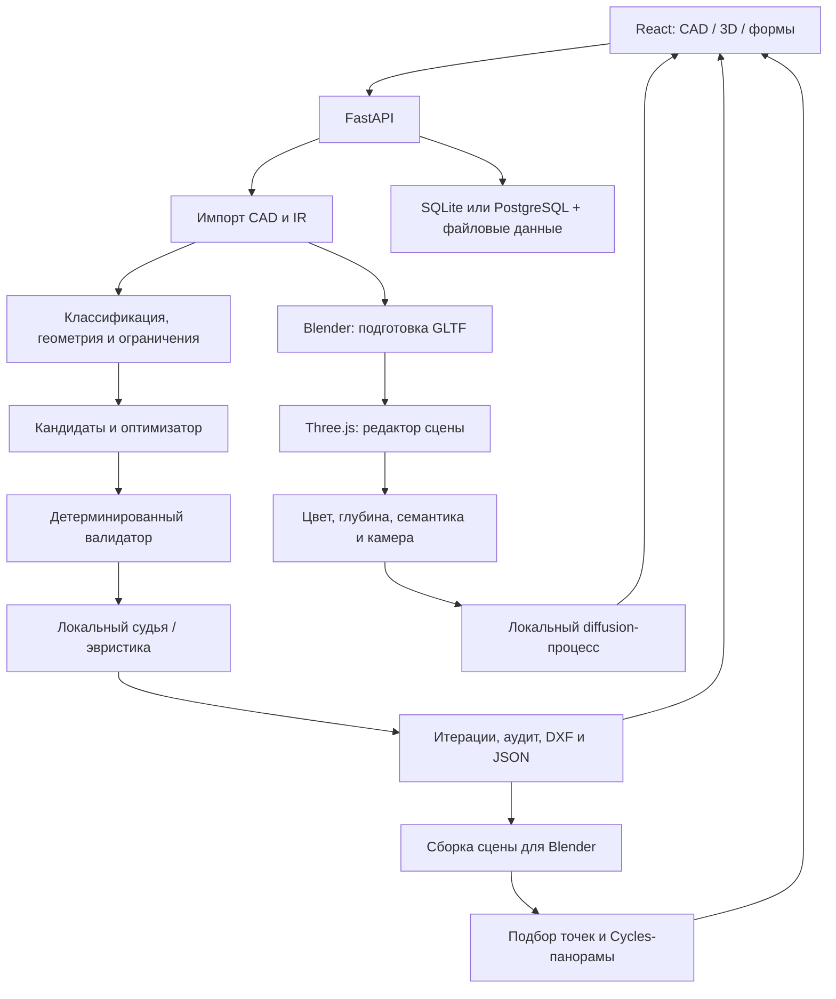

# GreenPlan: текущая архитектура и модули

Снимок реализации на 20 октября 2026 года. Документ описывает существующий код, а не целевую архитектуру. Путеводитель по экранным панелям и полям: [INTERFACE_GUIDE.md](INTERFACE_GUIDE.md). Детали моделей визуализации: [LOCAL_PHOTO.md](LOCAL_PHOTO.md) и [LOCAL_RENDER.md](LOCAL_RENDER.md).

## 1. Границы системы

GreenPlan принимает CAD-план, интерпретирует слои и геометрию, строит ограничения, размещает посадки, проверяет результат и экспортирует исходный чертёж с добавленными слоями. Отдельные ветки дают интерактивную 3D-сцену, локальное AI-фото по выбранной камере и Cycles-панорамы/туры.

Веб-интерфейс — React/TypeScript. API и прикладная логика — Python/FastAPI. Геометрия и нормативная проверка выполняются детерминированным кодом. Локальная LLM помогает с интерпретацией, условиями, мягкой оценкой и уточнением фото, но не заменяет нормативный валидатор.

Это одно API-приложение с фоновыми задачами и дочерними процессами, а не набор независимых микросервисов. Рендер-очереди находятся в памяти процесса API; локальные файлы сохраняют задания и результаты.

## 2. Структура репозитория

| Путь | Содержимое |
|---|---|
| `apps/web` | React-приложение, Three.js, стили и сборка Vite. |
| `apps/api/app` | FastAPI, конвейер, модели, хранилище и службы. |
| `apps/api/app/regulations` | Загрузка документов, фрагменты, извлечение и верификация нормативных условий. |
| `apps/api/app/assets` | Текстуры, HDR и Blender-ассеты для подготовки/рендера сцены. |
| `apps/api/tests` | Проверки геометрии, нормативов, API, фото, панорам и роста. |
| `rules` | YAML-реестры нормативов и пород, их параметры и происхождение. |
| `prompts` | Версионированные подсказки локальным моделям. |
| `fixtures`, `examples` | Тестовые и демонстрационные входы/результаты. |
| `evals` | Офлайн-оценка, регрессионные и эталонные кейсы; не пользовательская панель. |
| `tests/playwright` | Сценарии браузерного тестирования и скриншотов. |
| `scripts` | Установка Blender/фотомодели, развёртывание и вспомогательные операции. |
| `docs` | Пользовательская и техническая документация, BPMN, лицензии. |

## 3. Веб-приложение

### Каркас и состояние

| Модуль | Ответственность |
|---|---|
| `src/App.tsx` | Выбор глобального экрана; компоновка рабочего пространства, просмотра и нижнего инспектора. |
| `state/store.ts` | Общее состояние и подписки React: проект, слои, ограничения, итерации, выбор, параметры и навигация. |
| `state/actions.ts` | Операции загрузки проекта, запуска расчёта, выбора итерации, перемещения и изменения состояния. |
| `state/wizard.ts` | Состояние пошаговой конфигурации. |
| `api/client.ts`, `api/types.ts` | HTTP-клиент, контракты TypeScript и обработка API-ошибок. Для расчёта используются SSE с резервным polling. |
| `theme.ts`, `debug.ts`, `labels.ts` | Тема UI, режим отладки, пользовательские названия/подписи. |
| `components/ui.tsx`, `index.css` | Кнопки, иконки, badges, поля, dropdowns, единое оформление и анимации. |

### Экранные модули

| Модуль | Ответственность |
|---|---|
| `AdminDashboard.tsx` | Загрузка файлов и список проектов. |
| `TopBar.tsx` | Проект, навигация, запуск, экспорт, повторный импорт, исходный CAD, тема. |
| `Workspace.tsx`, `panels/*` | Интерпретация, ограничения, генерация и результат. |
| `Inspector.tsx`, `BottomSheet.tsx`, `StatusBar.tsx` | Выбранный объект, мобильная нижняя панель и строка состояния. |
| `Wizard.tsx` | Конфигурация: ограничения, условия, генерация, итоги. |
| `views/RegulationsView.tsx` | Работа с нормативными документами и кандидатами правил. |
| `views/RunsView.tsx`, `AuditView.tsx` | Итерации и подробный аудит соответствия. |
| `regulatory.tsx` | Единое отображение вердикта, блокеров и результатов проверок, включая старые итерации без вердикта. |
| `RenderWorkflow.tsx` | Вкладки «Тур»/«Рендер», общие параметры сцены, фото-задания и уточнение результата. |
| `PanoramaPanel.tsx` | Настройки и список панорам, автоматический тур, ручные точки и прогресс. |
| `PanelResize.tsx` | Изменение ширины боковых панелей с сохранением предпочтения. |

### Three.js

| Модуль | Ответственность |
|---|---|
| `viewer/ViewerCanvas.tsx` | Связь React и императивного менеджера сцены; применение выбранных параметров. |
| `SceneManager.ts` | Сцена и камеры, CAD/3D, выбор, hover, перемещение, материалы, маркеры, снимки для модели и восстановление состояния после съёмки. |
| `cadGeometry.ts`, `overlayGeometry.ts`, `plantSymbols.ts` | Геометрия CAD, зоны/дополнительные слои и условные обозначения посадок. |
| `blenderPreview.ts` | Запрос подготовленного окружения, загрузка GLTF, редактируемые растения и отдельные фото-материалы. |
| `dragCheck.ts` | Ограничение частоты и актуальность запросов живой проверки при перемещении. |
| `growth.ts`, `season.ts` | Масштабы растений по возрасту и условное сезонное окрашивание редактора. |
| `PanoramaViewer.tsx` | Сферический просмотр изображения, направления, переходы, мини-карта, полноэкранный режим. Это просмотр точек, а не свободное движение внутри AI-фотографии. |
| `renderFilters.ts`, `hud.ts` | Инфраструктура постобработки и быстрые обновления координат/масштаба. |

В активном 3D редакторе здания светлые без текстур; при подготовке AI-фото включаются сохранённые фото-материалы. Цветовой, глубинный и семантический входы снимаются одной камерой. Маркеры тура не включаются в снимки, учитывают глубину и не выбираются через непрозрачные объекты.

Сезон/возраст/план общие для обеих вкладок. Рамка фото и инструменты тура взаимно скрываются. Тема интерфейса не перестраивает 3D и не меняет камеру или вход фотомодели; отложенное перекрашивание CAD применяется при возвращении в CAD.

## 4. API, модели и хранение

| Модуль | Ответственность |
|---|---|
| `app/main.py` | HTTP-маршруты проектов, документов, ограничений, генерации, итераций, объяснений, живых проверок/перемещений, аудита, экспортов и визуализаций. Подключает нормативный router. |
| `app/models/ir.py` | Типизированное промежуточное представление CAD: документ, сущности, слои и классификация. |
| `app/config.py` | Пути, конвертеры, локальная LLM, лимиты и версии алгоритма/парсера через окружение. |
| `app/store.py` | Единый интерфейс хранения проектов, запусков и итераций. SQLite + JSON по умолчанию; PostgreSQL при заданном `DATABASE_URL`, с gzip-данными и локальным кэшем. |
| `app/pipeline.py` | Runtime проекта, подготовка геометрии/ограничений, выполнение расчёта и отслеживание стадий. |

`GREENPLAN_DATA_DIR` хранит загрузки, данные проектов и локальную БД. `GREENPLAN_OUTPUT_DIR` хранит экспортируемые и визуальные артефакты. Доступ к файлам изображения сам по себе не является записью проекта в БД. Секреты и фактические значения окружения не входят в этот документ.

## 5. Импорт, геометрия и размещение

Все модули таблицы находятся в `apps/api/app/services`.

| Модули | Назначение |
|---|---|
| `dwg_converter.py` | Поиск/вызов ODA File Converter или LibreDWG по настройкам, ограничения времени и ошибки преобразования DWG. |
| `cad_package.py` | Обработка CAD ZIP-пакетов, основной чертёж, xref и связи файлов. |
| `dxf_parser.py` | Чтение DXF через ezdxf, сущности, слои, блоки, единицы и IR. |
| `classification.py` | Классификация слоёв/объектов: ключевые слова, геометрия, при необходимости локальная модель. |
| `geometry.py`, `cache.py`, `chunking.py` | Нормализация/индексация геометрии, кэш вычислений и пространственные участки. |
| `rules.py` | Загрузка реестра нормативов и каталога пород, применение переопределений. |
| `constraints.py` | Ограничения от зданий, дорог, сетей, границ и прочих объектов; допустимая область. |
| `candidates.py` | Детерминированный подбор кандидатов с зерном генератора. |
| `optimizer.py` | Выбор посадок по стратегии и ограничениям, улучшение плана. |
| `validator.py` | Проверки расстояний/пересечений и детерминированный нормативный вердикт. |
| `judge_packet.py`, `judge.py`, `llm.py` | Пакет оценки, локальный судья, схема ответа, ограниченные повторные попытки и эвристический резерв. |
| `lawn.py` | Рекомендованные полигоны газона и их площадь. |
| `rejections.py`, `explain.py` | Причины отклонения кандидатов, происхождение проверок и объяснение выбранной посадки. |
| `dxf_export.py` | Сохранение исходного CAD с добавлением слоёв результата и метаданных посадок. |

Локальная LLM вызывается через OpenAI-совместимый HTTP-endpoint (`/v1/chat/completions`); это совместимость протокола, а не обязательный облачный сервис. Возможны Ollama/llama.cpp/vLLM и другие совместимые локальные runtime. Отсутствие модели не отменяет детерминированную проверку.

## 6. Нормативные документы

Модули `app/regulations`:

| Модуль | Ответственность |
|---|---|
| `router.py` | Документы, фрагменты, извлечение, текстовые условия, редактирование, проверка, активация/деактивация. |
| `docparse.py` | Разбор поддерживаемых документов и получение текста/фрагментов. |
| `models.py`, `storage.py` | Типы документов/кандидатов и их сохранение. |
| `extraction.py` | Извлечение кандидатов нормативных условий. |
| `verification.py` | Проверка значения, цитаты и подтверждающих сведений. |
| `integration.py` | Связь подтверждённых активных условий с вычисляемыми ограничениями. |

Кандидат правила и действующее подтверждённое правило — разные состояния. Геометрическое прохождение проверки по неподтверждённому значению не означает верифицированное соответствие. LLM-решение `ACCEPT` также не является нормативным вердиктом.

## 7. Три ветки визуализации

### Подготовка интерактивного 3D

1. `local_render.py` собирает описание сцены из CAD и выбранных посадок.
2. `source_reconstruction.py` уточняет распознанные здания/поверхности по исходным данным и настройкам; резервные высоты остаются явными предположениями.
3. `preview_jobs.py` организует подготовку Blender-окружения и кэш GLTF.
4. `blender_scene.py` создаёт геометрию; `render_geometry.py`, `source_materials.py`, `preview_materials.py`, `blender_landscape.py` предоставляют геометрию, материалы и растения.
5. Браузер загружает модель и добавляет независимые редактируемые посадки.

### Локальное фото выбранной камеры

| Модуль | Роль |
|---|---|
| `photo_jobs.py` | Валидация PNG-входов, ограниченная очередь, сохранение настроек/камеры/плана, запуск дочернего процесса, прогресс и список результатов. |
| `photo_inference.py` | Самостоятельный diffusion-worker: загрузка локальных весов, подготовка контролирующих изображений и генерация. |
| `photo_styles.py` | Ограниченные параметры внешнего вида и сезонные/возрастные подсказки. |
| `photo_quality.py` | Разрешения и план детализации. |
| `photo_upscale.py` | Локальное повышение разрешения с Real-ESRGAN, включая обработку плитками. |
| `photo_chat.py` | Уточнение внешнего вида через локальную LLM с сохранением привязки к плану/камере. |

Используются Realistic Vision 5.1 и ControlNet segmentation, PyTorch/diffusers/transformers. Фотомодель и API имеют отдельные Python-окружения. Файлы задания включают входные PNG, настройки, статус и результат. Зима влияет на фото-подсказку и кондиционирующий фон; снег применяется к наземным поверхностям при съёмке. Возраст уже отражён масштабом входных посадок. Диффузионное изображение остаётся иллюстративным и может отклоняться в деталях.

### Панорамы и туры

| Модуль | Роль |
|---|---|
| `panorama_tour.py` | Выбор точек на дорожках/газонах и связей с учётом видимости и препятствий. |
| `render_jobs.py` | Ограниченная очередь Cycles, Blender subprocess, файлы заданий, прогресс и выдача изображений. Один процесс может последовательно рендерить все точки тура. |
| `blender_scene.py` | Equirectangular-камера, высота глаз, параметры разрешения/сэмплов, сцена и выходные изображения. |
| `blender_grass.py` | Локальные инстансы травы внутри подходящих поверхностей. |
| `growth.py` | Породная модель роста по возрасту; проверяется против TypeScript `growth.ts`. |
| `blender_season.py` | Листва, сезонные материалы, снег, свет и зимнее отключение травинок. |

Панорамы — Cycles-изображения исходной 3D-сцены, а не результат фотодиффузии. Навигация связывает отдельные точки; промежуточных полноценных 3D-фотографий между ними нет. На CPU высокое качество и много точек могут занимать часы. Высота, размер кроны и сезон здесь изменяются сценой Blender, а не только текстом подсказки.

## 8. Очереди, состояния и восстановление

- Генерация посадок имеет стадии и события SSE; веб-клиент умеет переходить на опрос статуса.
- Фото и Cycles имеют отдельные ограниченные фоновые очереди и дочерние процессы. Их статусы сохраняются в `outputs/photo_jobs` и `outputs/render_jobs`; подготовленные сцены — в `outputs/editor_previews`.
- Текущая реализация использует локальные thread pools, семафоры и файловые статусы. Redis/Celery не требуются и не являются текущей архитектурой.
- Рестарт API не равен возобновлению очереди: незавершённые задания могут быть показаны как ошибочные. Файлы завершённых результатов сохраняются.
- Веб-интерфейс опрашивает состояние визуализации; переключение вкладок само по себе не запускает новую генерацию.
- Фоновая работа ресурсоёмкая. Процессы Blender и фотомодели могут конкурировать за CPU/память.

## 9. Библиотеки и инфраструктура

| Слой | Основные используемые компоненты |
|---|---|
| UI | React 18, TypeScript, Vite, Tailwind CSS, vite-plugin-pwa. |
| Графика | Three.js, GLTF/HDR-загрузчики, WebGL. |
| API | FastAPI, Uvicorn, Pydantic, httpx, python-multipart, aiofiles. |
| CAD/геометрия | ezdxf, Shapely, NumPy; внешние ODA/LibreDWG для DWG. |
| Документы | pypdf, python-docx, striprtf. |
| Данные | SQLite стандартной библиотеки; psycopg для PostgreSQL; PyYAML для реестров. |
| Изображения/шрифты | Pillow, fonttools; Blender/Cycles как отдельная установка. |
| AI-фото | PyTorch отдельно под CPU/CUDA, diffusers, transformers, accelerate, safetensors, huggingface_hub; локальные веса. |
| Проверки | pytest, Playwright, офлайн-модули `evals`. |

Точные ограничения версий находятся в `apps/web/package.json`, lock-файлах, `apps/api/requirements.txt` и `requirements-photo.txt`. Наличие зависимости не означает её использование в каждом запросе.

Текущее развёртывание использует nginx для статического `apps/web/dist` и `/api`-прокси, API как systemd-службу `greenplan-api`, окружение API, отдельное окружение фотомодели и установленный Blender. Рабочие файлы расположены под `/opt/greenplan`. Репозиторий также содержит Dockerfiles и `docker-compose.yml` для альтернативного запуска; Docker Compose не следует автоматически считать способом запуска боевого сервера.

## 10. Неактивные и вспомогательные части

- `RenderDialog.tsx`, `RenderFilterPanel.tsx` не подключены как самостоятельные панели текущего основного просмотра.
- `massing3d.ts`, `botanicalAssets.ts`, `landscapeVegetation.ts` сохранены как старые/вспомогательные пути; основной редактор использует `blenderPreview.ts`.
- `QualityView.tsx` и API офлайн-оценки сохранены в коде, но кнопка служебной страницы убрана из пользовательской навигации.
- Ветка свободной прогулки с перетаскиваемым человеком удалена. Панорамы/туры и фото-пресет камеры с уровня человека остаются.
- Новые возможности чужой ветки не считаются внедрёнными только потому, что существуют в другом репозитории: сравнение вариантов и ведомость посадок не включены в этот снимок как отдельные активные модули.

## 11. Конфигурация и точки изменения

Основные настройки: `DATABASE_URL`, `GREENPLAN_DATA_DIR`, `GREENPLAN_OUTPUT_DIR`, `GREENPLAN_RULES_FILE`, `GREENPLAN_SPECIES_FILE`, параметры DWG-конвертера и `LOCAL_LLM_*` из `config.py`. Настройки Blender/фотомодели читаются также соответствующими job-модулями и установочными скриптами.

- Новый элемент UI: компонент + actions/store при необходимости; HTTP-контракт — `api/types.ts` и Python request model.
- Новая геометрическая проверка: реестр/условия → ограничения/валидатор → объяснения → тесты. Визуализация не должна подменять нормативный результат.
- Новый параметр визуализации: согласовать React-поле, request model, настройки задания, сборку сцены/worker и отображение сохранённого результата.
- Изменение роста: синхронизировать Python и TypeScript, проверить общие эталонные точки.
- Проверка сборки UI: `npm --prefix apps/web run build`.
- Проверки API: `python -m pytest apps/api/tests` в окружении с API-зависимостями.

Для изменений рендера требуются соответствующие локальные модели/Blender; успешная сборка веб-приложения сама по себе не проверяет качество длинного Cycles- или diffusion-рендера.
