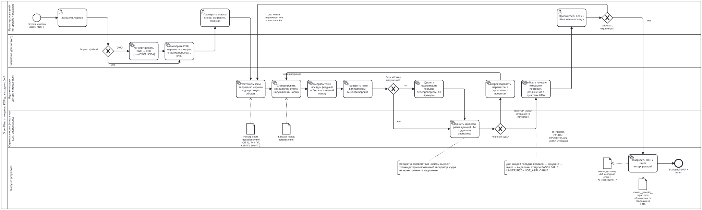

# GreenPlan — сопроводительная документация

Сервис автоматического проектирования озеленения с учётом подземных коммуникаций и городской среды.
ЛЦТ 2026, кейс «Контроль Москвы. Экология».

| | |
|---|---|
| Версия алгоритма | 0.3.0 (`ALGORITHM_VERSION`) |
| Версия реестра норм | 0.3.0 (`rules/regulations.yaml`) |
| Дата документа | 27.09.2026 |
| Репозиторий | https://github.com/PolarBearChamp/lct-green |
| Схема процесса (BPMN 2.0) | [`docs/bpmn/greenplan-process.bpmn`](bpmn/greenplan-process.bpmn) |

Разделы документа повторяют раздел 5 технического задания.

1. [Назначение и границы решения](#1-назначение-и-границы-решения)
2. [Архитектура](#2-архитектура)
3. [Описание работы алгоритма](#3-описание-работы-алгоритма)
4. [Используемые методы и библиотеки](#4-используемые-методы-и-библиотеки)
5. [Инструкция по сборке, запуску и проверке](#5-инструкция-по-сборке-запуску-и-проверке)
6. [Способ взаимодействия](#6-способ-взаимодействия)
7. [HTTP API и Swagger](#7-http-api-и-swagger)
8. [Ограничения, допущения, известные ошибки](#8-ограничения-допущения-известные-ошибки)

---

## 1. Назначение и границы решения

GreenPlan принимает чертёж участка (DXF или DWG), распознаёт на нём здания, дороги, тротуары, инженерные сети и существующие насаждения, строит зоны, где посадка запрещена нормами, и генерирует план посадки деревьев и кустарников. Результат выгружается обратно в DXF на отдельные слои `AI_GREENING_*`; исходные слои не изменяются. К каждой посадке прилагается объяснение: какие нормы проверены, какое расстояние фактическое и какое требуется, со ссылкой на нормативный акт и конкретный пункт.

Ядро решения детерминированное: нормы, геометрия, оптимизация и проверка не зависят от нейросети и воспроизводимы при одинаковых входе, параметрах и `seed`. Локальная LLM используется только как «судья» качества размещения и при разборе загружаемых нормативных документов. Без неё пайплайн работает полностью (судья переключается на детерминированную эвристику).

**Для кого:** специалисты ДПиООС и подведомственных организаций, проектировщики благоустройства и озеленения, участники согласования проектов городской среды.

### Что входит в MVP

| Требование ТЗ | Как реализовано |
|---|---|
| Приём DXF / DWG | Загрузка через веб-интерфейс или API; DWG конвертируется в DXF (LibreDWG в Docker-образе или ODA File Converter) |
| Приём пакета исходных данных (геоподоснова + коммуникации + границы) | ZIP-пакет генплана с внешними ссылками (как выдан для «Пилотного проекта 20 улиц»): топоплан, существующие и проектируемые сети, красные линии, границы работ, покрытия сводятся в один чертёж |
| Анализ ограничений, карта «где можно сажать» | Реестр норм → буферы запрета вокруг объектов → допустимая область посадки |
| Рекомендация локаций для деревьев и кустарников | Кандидаты (Poisson-disc) → фильтр по нормам → оптимизатор с 4 стратегиями |
| Автогенерация плана с соблюдением норм | Детерминированный валидатор — последняя инстанция; нарушающие посадки удаляются |
| Результат на отдельных слоях | `AI_GREENING_TREES`, `…_SHRUBS`, `…_ALLOWED_ZONE`, `…_EXCLUSIONS`; исходные слои не меняются (проверяется тестом и скриптом) |
| Корректировка результата | Перезапуск с другими параметрами, переклассификация слоёв, включение и выключение правил |
| Экспорт в DXF | `<имя>_greening.dxf`: исходный чертёж плюс слои результата, метаданные посадок в XDATA |
| Интерпретируемость каждой посадки | JSON-отчёт и Инспектор в интерфейсе: правило → документ → пункт → выдержка, фактическое и требуемое расстояние |
| Docker, Swagger | `docker compose up --build`; Swagger на `/docs` |

### Что оставлено на развитие

- Газоны, цветники и типовые элементы скверов — сейчас генерируются только деревья и кустарники.
- Класс напряжения ЛЭП от пользователя (сейчас принята линия до 1 кВ по расположению у опор освещения); охранные зоны подстанций и иные зоны охраны.
- Ассортимент растений из файлов заказчика (`Ассортимент ….xlsx`) — сейчас используется встроенный каталог из 7 пород.
- Отдельная CLI-утилита — сейчас прогон из терминала выполняется командами `curl` к API (раздел 5.3).
- Бонусное задание: фотореалистичные визуализации не реализованы.

---

## 2. Архитектура

### 2.1. Компоненты

| Компонент | Технология | Назначение |
|---|---|---|
| Веб-интерфейс | React 18, TypeScript, three.js, Tailwind, Vite (PWA) | Загрузка, мастер из 4 шагов, 2D/3D-просмотр чертежа и плана, Инспектор посадки, реестр норм, история запусков |
| Прокси | nginx (в контейнере `web`) | Отдаёт статический фронтенд, проксирует `/api/*` в контейнер `api` (в том числе SSE-поток прогресса) |
| HTTP API | FastAPI, Uvicorn, Pydantic | Проекты, генерация, объяснения, экспорт, реестр норм, загрузка нормативных документов; OpenAPI / Swagger |
| Конвертер DWG | LibreDWG 0.13.3 (собирается в образе) или ODA File Converter | DWG → DXF, запускается подпроцессом без shell, с таймаутом |
| Разбор CAD | ezdxf | Чтение DXF, санитизация повреждённых файлов, перевод в метры, внутреннее представление (IR) |
| Геометрическое ядро | Shapely (GEOS), NumPy | Буферы, разность областей, пространственные индексы STRtree, точные расстояния |
| Реестр норм | `rules/regulations.yaml` | 34 правила: расстояния, условия применимости, источники с пунктом, выдержкой и страницей PDF |
| Каталог пород | `rules/species.yaml` | 7 пород: латинское название, радиус кроны, высота |
| Хранилище | SQLite + JSON на диске (по умолчанию) или PostgreSQL (`DATABASE_URL`) | Проекты, запуски, итерации, объяснения |
| Локальная LLM (опционально) | Любой OpenAI-совместимый сервер: Ollama, llama.cpp, vLLM; модель семейства Qwen2.5 | Судья качества размещения; извлечение правил из загружаемых PDF/DOCX. Облачные API не используются |

### 2.2. Потоки данных

1. Файл загружается в API (`POST /api/projects`), проверяются расширение, сигнатура и размер (до 200 МБ). DWG конвертируется в DXF; ZIP-пакет с внешними ссылками собирается в один DXF (раздел 3.2, шаг 1).
2. DXF разбирается в IR: сущности в метрах, слои, экстенты. Слои классифицируются по семантическим категориям (здание, дорога, водопровод, теплосеть…).
3. По реестру норм строятся зоны запрета и допустимая область; результат кэшируется до изменения классификации слоёв.
4. Запуск генерации (`POST …/generate`) выполняется в фоне; прогресс передаётся через SSE (`…/runs/{id}/events`).
5. Каждая итерация сохраняется целиком: параметры, `seed`, посадки, отчёт валидатора, отчёт судьи, хэш входного файла, версии алгоритма и реестра.
6. Экспорт (`…/export/dxf`, `…/export/report`) собирается из выбранной итерации.

LLM получает только компактные сводки: имена слоёв и гистограммы типов сущностей для классификации, агрегированные метрики и зоны для судьи. Сырой CAD в модель не передаётся, и LLM не может изменить вердикт о соответствии нормам — это ограничено в коде, а не в промпте.

### 2.3. Схема развёртывания

```text
                ┌──────────────────────── docker compose ─────────────────────────┐
  браузер ──▶  │  web  (nginx :80 → хост :5173)                                  │
               │    ├── /          статический фронтенд (React, three.js)         │
               │    └── /api/*  ─▶ api  (FastAPI :8000 → хост :8000)             │
               │                    ├── LibreDWG dwg2dxf (внутри образа)          │
               │                    ├── ./rules    → /repo/rules    (только чтение)│
               │                    ├── ./prompts  → /repo/prompts  (только чтение)│
               │                    ├── ./fixtures → /repo/fixtures (тестовые DXF)│
               │                    ├── ./outputs  → /repo/outputs               │
               │                    └── том api-data → /repo/data (проекты, БД)  │
               └──────────────────────────────┬───────────────────────────────────┘
                                              │ http://host.docker.internal:11434
                                              ▼  (опционально)
                                   локальная LLM: Ollama / llama.cpp / vLLM
```

Реестр норм смонтирован из рабочей копии, поэтому правка `rules/regulations.yaml` применяется без пересборки образа. Kubernetes не используется.

---

## 3. Описание работы алгоритма

### 3.1. Подход

Решение гибридное. Всё, что касается норм, — детерминированный алгоритм: правила хранятся как данные, расстояния считаются по точной геометрии, итог проверяет валидатор. Нарушение нормы делает кандидата недопустимым; оно никогда не превращается в штраф в оценке, который можно «перевесить». LLM отвечает только на вопрос «стоит ли ещё одна итерация оптимизации», и её ответ ограничен по допустимым параметрам.

Почему так: нормы в ТЗ жёсткие и однозначные, и эксперт должен иметь возможность проверить каждое решение по пункту НПА. Нейросеть в роли источника решений о посадке сделала бы результат непроверяемым.

### 3.2. Шаги пайплайна

**1. Приём и конвертация.** DXF читается напрямую; DWG конвертируется в DXF через LibreDWG или ODA File Converter. Файлы с дефектами после конвертации (например, «разорванные» строки) исправляются санитайзером перед разбором.

Исходные данные пилотных объектов — пакет AutoCAD eTransmit: основной чертёж генплана почти пуст, а топоплан, сети и границы подключены к нему как внешние ссылки (xref). Такой пакет загружается одним ZIP-файлом и собирается модулем `cad_package`:
- архив распаковывается с защитой от выхода за пределы каталога и от «zip-бомб»; кириллические имена из архивов Проводника Windows (cp866) декодируются;
- основной чертёж берётся из отчёта eTransmit («Базовый чертеж»), а без отчёта — это чертёж верхнего уровня с наибольшим числом внешних ссылок;
- из таблицы внешних ссылок основного чертежа берутся пути (в стиле Windows, относительно основного чертежа) и точки вставки; каждый файл находится в пакете, конвертируется и копируется в общий чертёж со слоями `<ссылка>$0$<слой>` — так же, как их называет AutoCAD при внедрении ссылок;
- всё обрезается по границам работ с запасом 15 м (больше самого большого нормативного отступа); часть границы работ, внутри которой нет содержимого чертежа (например, копия контура в стороне от плана — так на Харьковском проезде), участком не считается, хотя в чертеже остаётся;
- класс слоя уточняется по файлу-источнику: границы работ — граница участка (и только они), рамки съёмки (`brd`) и красные линии (`kl`) — служебные пометки, всё из выгрузок сетей (`up`, `pp`) — сети.

Файлы ИРД различаются по суффиксу: `tp` — топоплан, `up` — существующие подземные сети, `pp` — проектируемые сети, `kl` — красные линии, `brd` — рамки листов и граница заказа съёмки.

**2. Разбор.** ezdxf читает модельное пространство; координаты переводятся в метры по `$INSUNITS`; окружности, дуги и полилинии превращаются в геометрию Shapely. DIMENSION-сущности сохраняются при экспорте, но не рисуются в просмотрщике.

**3. Классификация слоёв.** Три ступени:
1. правила по ключевым словам в имени слоя (регулярные выражения, включая реальные имена слоёв выгрузок Мосгеотреста: «Водосток» → канализация, «Кабель связи» → связь);
2. геометрические подсказки для слоёв без понятного имени;
3. локальная LLM — только для оставшихся неуверенных слоёв (уверенность < 0,6, не более 20 слоёв).

У каждого слоя сохраняются категория и уверенность; при уверенности ниже 0,65 слой помечается «требует проверки», и пользователь исправляет его одним кликом.

**4. Граница участка и область посадки.** Граница — замкнутая полилиния на слое границ; незамкнутые куски, сходящиеся концами (допуск 2 м), сшиваются в контур — так начерчены «Границы работ» пилотного объекта. Границы работ из пакета объединяются, даже если это несколько отдельных площадок. Если в чертеже есть план покрытий («заливки», слои вида `_АБ ТР-ГЗН` — «асфальт тротуара → газон»), область посадки — проектные газоны внутри границы; вторая половина имени слоя — то, что строится по проекту (ГЗН — газон, ПЧ — проезжая часть, ТР — тротуар, ПЛ — плитка, Щ — щебень). Если границы нет, область посадки выводится из признаков озеленения на чертеже или из его экстентов, и в вердикт добавляется блокер `SITE_BOUNDARY_UNKNOWN`.

**5. Зоны запрета.** Для каждого действующего правила «минимальное расстояние» вокруг объектов нужной категории строится буфер на требуемое расстояние. Допустимая область = область посадки − контуры объектов − все буферы − треугольники видимости на пересечениях проездов; узкие «щели» уже 1 м отбрасываются. Линейные дороги и тротуары, нарисованные осевыми линиями, получают условную ширину 0,3 м.

**6. Кандидаты.** Для каждой выбранной породы точки генерируются выборкой Пуассоновского диска (алгоритм Бриджсона) с генератором случайных чисел, инициализированным `seed`. Радиус выборки равен шагу посадки породы (деревья — 5 м, кустарники — не меньше 2 м). Выборка идёт по участку с запасом 6 м за пределы допустимой области, чтобы отклонённые точки были видны на плане. Для каждого кандидата точно вычисляются расстояния до зданий, дорог, тротуаров, сетей, существующих деревьев и т. д.

**7. Жёсткий фильтр.** Кандидат отбрасывается, если он вне допустимой области или ближе требуемого к объекту по любому обязательному правилу. Здесь же применяются правила, зависящие от породы (623-ПП п. 4.2.8: отступ от теплотрассы для липы — 2 м, для лиственницы — 4 м).

**8. Оптимизация.** Жадный отбор: на каждом шаге выбирается кандидат с наибольшей оценкой, после чего из оставшихся удаляются кандидаты ближе шага посадки к выбранному. Затем выполняется локальный поиск: до 30 попыток заменить самую слабую посадку неиспользованным кандидатом. Оценка кандидата:

```text
score = 1
      + w_spacing      · min(1, запас_до_существующих_деревьев_и_границы / 15 м)
      + w_coverage     · радиус_кроны / 5 м
      + w_distribution · 1 / (1 + число_посадок_в_квадрате_25×25 м)
      + w_street       · max(0, 1 − расстояние_до_дороги_или_тротуара / 20 м)
```

| Стратегия | Что меняется относительно `balanced` |
|---|---|
| `balanced` (по умолчанию) | w_spacing 0,35; w_coverage 0,45; w_distribution 0,40; w_street 0,15; плотность кандидатов 1,0 |
| `maximum_trees` | плотность 1,6; w_spacing 0,1; w_coverage 0,3 |
| `maximum_canopy` | w_coverage 0,9; плотность 1,2 |
| `street_greening` | w_street 0,8; w_distribution 0,25 |

Количество посадок по умолчанию — одна на (2,5 × шаг)² допустимой площади, не более 400 на породу; его можно задать явно (`targetCount`).

**9. Валидация и вердикт.** Валидатор заново проверяет каждую посадку по всем правилам на точной геометрии и присваивает каждой паре «правило × посадка» статус:

| Статус | Когда |
|---|---|
| `PASS` | расстояние соблюдено, значение правила подтверждено первоисточником, условия применимости выполнены |
| `FAIL` | расстояние нарушено |
| `UNVERIFIED` | расстояние соблюдено, но значение — демо-допущение или технологический буфер, либо не подтверждено условие применимости (например, крона шире 5 м для табл. 9.1 СП 42) |
| `NOT_APPLICABLE` | объектов этой категории на чертеже нет |

Итоговый вердикт: `NON_COMPLIANT` при любом `FAIL`; `NEEDS_REVIEW` («требует проверки»), если есть непроверенные обязательные правила или блокеры; `COMPLIANT` — только когда все применимые обязательные проверки прошли по подтверждённым значениям. Доля подтверждённых проверок выводится как «нормативное покрытие».

Соблюдённый технологический запас проекта, который никакая норма не задаёт (3 м от существующего дерева), в вердикт и покрытие не входит: подтверждать по НПА в нём нечего, а в объяснении посадки он показан как «не нормативная проверка». Буфер от сети неопознанного типа входит — он заменяет норму, которая зависит от типа сети (у теплотрассы для части пород — до 4 м), поэтому эксперт должен её подтвердить. Нарушение любого буфера — `FAIL`.

**10. Детерминированный ремонт.** Если валидатор нашёл нарушения, нарушающие посадки удаляются и план перепроверяется, не более трёх проходов. Судья запускается только на плане без нарушений.

**11. Судья и итерации.** Судья (локальная LLM или детерминированная эвристика) получает сводку: распределение по квадрантам, кластеры, недоиспользованные зоны, метрики. Он отвечает `ACCEPT`, `RERUN` или `MANUAL_REVIEW`. При `RERUN` предлагаемые изменения параметров проходят белый список, проверку диапазона и ограничение на величину шага, после чего запускается новая итерация (по умолчанию не более 3). Новая итерация заменяет выбранную, только если она тоже без нарушений и лучше по целевой метрике. Уверенность судьи ограничена сверху величиной `0,3 + 0,7 · нормативное_покрытие`.

**12. Объяснения и экспорт.** Для каждой посадки выбранной итерации строится объяснение (раздел 3.7), затем формируются DXF и JSON-отчёт.

### 3.3. Нормативные отступы

Значения взяты из текстов документов в `dataset/госты/`; у каждого правила в реестре есть пункт, дословная выдержка и ссылка на страницу PDF.

| Объект | Дерево, м | Кустарник, м | Источник |
|---|---|---|---|
| Наружная стена здания | 5,0 | 1,5 | СП 42.13330.2016 п. 9.6, табл. 9.1; 743-ПП п. 3.6.3, табл. 3.6.1; 623-ПП п. 4.2.4 |
| Край проезжей части, бортовой камень | 2,0 | 1,0 | то же |
| Край тротуара, садовой дорожки | 0,7 | 0,5 | то же |
| Опора освещения | 4,0 | — | СП 42 табл. 9.1; 743-ПП табл. 3.6.1; 623-ПП п. 4.8.14 |
| Водопровод, дренаж | 2,0 | — | СП 42 табл. 9.1; 743-ПП табл. 3.6.1; 623-ПП п. 4.2.4 |
| Газопровод, канализация (включая ливневую) | 1,5 | — | то же |
| Теплосеть (теплопровод, трубопровод) | 2,0 | 1,0 | то же |
| Силовой кабель, кабель связи | 2,0 | 0,7 | то же |
| Охранная зона подземного силового кабеля | — | 1,0 | ПП РФ № 160, приложение п. «б»; п. 11 «з» (для деревьев строже СП 42 — 2,0) |
| Охранная зона воздушной ЛЭП до 1 кВ (вдоль провода) | 2,0 | 2,0 | ПП РФ № 160, приложение п. «а»; п. 11 «з» |
| Теплотрасса: липа, клён, сирень, жимолость | 2,0 | 2,0 | 623-ПП (МГСН 1.02-02) п. 4.2.8 |
| Теплотрасса: тополь, боярышник, кизильник, дерен, лиственница, берёза | 4,0 | 4,0 | 623-ПП п. 4.2.8 (в норме «3–4 м», принято верхнее значение) |
| Треугольник видимости на нерегулируемом пересечении | запрет насаждений выше 0,5 м в треугольнике 8 × 40 м | | 623-ПП п. 9.4.2 |
| Шаг между деревьями / кустарниками (рекомендация) | 5,0 | 1,0 | 743-ПП п. 3.6.4, табл. 3.6.2 |
| Инвазивные виды | запрет 31 таксона | | 369-ПП приложение 1 |
| Существующее дерево (технологический буфер) | 3,0 | 3,0 | норма не найдена, как норма не цитируется |
| Сеть неопознанного типа (технологический буфер) | 2,0 | — | максимум строк «подземные сети» табл. 9.1 |

Таблица 9.1 СП 42 (и её копия 3.6.1 в 743-ПП) действует для деревьев с кроной не шире 5 м (примечание 1). Для пород с более широкой кроной проверка получает статус `UNVERIFIED` с пояснением «требуется увеличенное расстояние».

Охранные зоны ЛЭП (ПП РФ № 160) задают не отступ, а зону, где посадка деревьев и кустарников запрещена без условий решения о согласовании охранной зоны (п. 11 «з»); алгоритм такие зоны обходит. Ширина зоны воздушной линии зависит от класса напряжения (до 1 кВ — 2 м, 1–20 кВ — 10 м, 35 кВ — 15 м, 110 кВ — 20 м), а в чертежах он не указан. В топопланах Мосгеотреста знаки слоя «ЛЭП» стоят у опор наружного освещения — это линии до 1 кВ, поэтому принята зона 2 м; проверка получает статус `UNVERIFIED` с пояснением, откуда взят класс и что для линий выше 1 кВ зона шире. Провод между опорами в топоплане не нарисован — только знак у каждой опоры (штрих 2,5 м и стрелка вдоль линии). Зона строится вдоль провода: каждый знак соединяется с ближайшим знаком впереди и позади по направлению своей стрелки (не дальше 60 м, отклонение меньше 20°), знаки на другой стороне улицы не соединяются. Воздушные линии распознаются отдельно от кабелей по именам слоёв «ЛЭП», «ВЛ», «воздушная линия».

Строки таблиц, для объектов которых на чертеже пока нет категории, внесены в реестр с цитатой, но выключены: трамвайные пути (5,0 / 3,0), подошва откоса (1,0), подпорная стенка (3,0), ЛКС ТМК (1,0), стены школ и детских садов (10,0).

### 3.4. Типы посадок

| Порода | Тип | Латинское название | Радиус кроны, м |
|---|---|---|---|
| Липа мелколистная | дерево | *Tilia cordata* | 3,5 |
| Клён остролистный | дерево | *Acer platanoides* | 4,0 |
| Рябина обыкновенная | дерево | *Sorbus aucuparia* | 2,5 |
| Лиственница сибирская | дерево | *Larix sibirica* | 3,0 |
| Сирень обыкновенная | кустарник | *Syringa vulgaris* | 1,5 |
| Кизильник блестящий | кустарник | *Cotoneaster lucidus* | 0,8 |
| Чубушник венечный | кустарник | *Philadelphus coronarius* | 1,2 |

Перед генерацией каждая выбранная порода проверяется по перечню инвазивных видов 369-ПП; попавшие в него отклоняются. Каталог — файл `rules/species.yaml`, расширяется без изменения кода.

### 3.5. Приоритеты

1. **Нормы — фильтр, а не штраф.** Кандидат, нарушающий обязательное правило, не может попасть в план ни при какой оценке.
2. **Безопасное направление.** Если норма не подтверждена, используется помеченное демо-значение или технологический буфер, но проверка никогда не получает `PASS`. Если порода неизвестна каталогу, породоспецифичные правила к ней применяются.
3. **Ничего не выдумывается.** Правило получает статус «подтверждено», только если в реестре есть пункт документа, дословная выдержка и ссылка на страницу. Это проверяют тесты.
4. **Качество размещения** (равномерность, покрытие кронами, связь с улицей) оптимизируется только внутри допустимой области.

### 3.6. Работа со слоями DXF

Экспорт открывает исходный DXF, добавляет слои результата и сохраняет файл под новым именем. Исходные сущности и слои не изменяются и не удаляются.

| Слой | Цвет ACI | Содержимое |
|---|---|---|
| `AI_GREENING_TREES` | 3 (зелёный) | Блоки `AI_TREE`, масштаб равен радиусу кроны |
| `AI_GREENING_SHRUBS` | 92 (светло-зелёный) | Блоки `AI_SHRUB` |
| `AI_GREENING_ALLOWED_ZONE` | 4 (голубой) | Контуры допустимой области посадки |
| `AI_GREENING_EXCLUSIONS` | 1 (красный) | Зоны запрета, объединённые по правилам; в XDATA — `rule_id` |
| `AI_GREENING_REJECTED` | 6 (пурпурный) | Отклонённые точки-кандидаты (выборка до 1 500); в XDATA — все причины (`reason=<правило или причина>`) |

Выгружаются два варианта: полный (исходный чертёж со слоями результата; для пакета — сводный чертёж, обрезанный по границам работ) и только слои результата в координатах исходного чертежа (`?layers=result`) — его проектировщик подключает к своему генплану как внешнюю ссылку.

Перед записью чертёж исправляется так, чтобы его открыл AutoCAD (ezdxf читает его и без этого): удаляются вставки блоков, которые LibreDWG не сконвертировал, и размеры без блока геометрии; штриховки становятся неассоциативными; ссылки слоёв на материалы и стили печати исходных файлов сбрасываются на значения слоя «0»; элементы сложных типов линий без подходящего стиля заменяются штрихами. В выгрузках пилотных объектов после этого нет ни одной висящей ссылки.

У каждой посадки есть XDATA приложения `GREENPLAN`: `planting_id`, `species_id`, `kind`, номер итерации, `rule_set_version`, оценка оптимизатора. По `planting_id` посадка связывается с объяснением в JSON-отчёте.

Сохранность исходного чертежа проверяется двумя способами: тестом `test_dxf_export_roundtrip` и скриптом `apps/api/scripts/check_dxf_layers.py` (раздел 5.5). Скрипт сверяет каждую исходную сущность (дескриптор, тип, слой) и свойства каждого исходного слоя и убеждается, что всё новое лежит только на слоях `AI_GREENING_*`.

### 3.7. Интерпретируемость

**Откуда берутся ссылки на нормы.** Правила — данные в `rules/regulations.yaml`. У каждого правила есть:
- применимость (тип посадки, категория объекта, при необходимости — роды растений);
- ограничение (расстояние в метрах);
- условие применимости (например, крона не шире 5 м);
- источник: документ, пункт, дословная выдержка, путь к PDF с номером страницы;
- `also_cited` — другие акты, устанавливающие то же требование (743-ПП повторяет таблицу СП 42; 623-ПП требует её отсылкой к табл. 7.6 МГСН 1.01-99);
- статус проверки (`verified` / `missing_source_data`) и роль (`regulatory` — правовая норма, `safe_buffer` — технологический буфер, `design_heuristic` — проектная рекомендация).

В шапке реестра ведётся журнал сверки с первоисточниками: что, когда и по каким страницам проверено.

**Как строится объяснение.** Для каждой посадки перебираются все правила, применимые к её типу и породе. Для каждого правила вычисляется точное расстояние до ближайшего объекта нужной категории и определяется статус (раздел 3.2, шаг 9). В объяснение попадают:
- `ruleId`, результат, фактическое и требуемое расстояние;
- категория объекта;
- источник с пунктом и `alsoCited`;
- причина, если результат не `PASS` (например, «крона 8,0 м > 5 м — табл. 9.1 недостаточна, требуется увеличенное расстояние»).

Отдельно фиксируется проверка «посадка в границах участка».

**Пример** (фрагмент реального отчёта для примера `synthetic_site.dxf`, рябина):

```json
{
  "plantingId": "tree_rowan_0_0",
  "position": [142.625, 116.566],
  "speciesId": "tree_rowan",
  "checks": [
    {
      "ruleId": "TREE_BUILDING_MIN_DISTANCE",
      "result": "PASS",
      "actualM": 53.03,
      "requiredM": 5.0,
      "comparator": ">=",
      "obstacleCategory": "BUILDING",
      "effectiveSource": "verified",
      "role": "regulatory",
      "source": {
        "document": "СП 42.13330.2016",
        "clause": "п. 9.6, таблица 9.1",
        "title": "Расстояние от наружной стены здания до оси ствола дерева",
        "status": "verified",
        "alsoCited": [
          { "document": "ППМ № 743-ПП", "clause": "п. 3.6.3, таблица 3.6.1", "relation": "same_value" },
          { "document": "ППМ № 623-ПП", "clause": "п. 4.2.4", "relation": "reference" }
        ]
      },
      "reason": null
    }
  ]
}
```

**Где эксперт видит объяснения:**
- в веб-интерфейсе — клик по посадке открывает Инспектор со всеми проверками, пунктами норм и строкой «также: …»;
- в файле `<имя>_greening_report.json` — объяснения всех посадок, вердикт, перечень применённых и неактивных правил, параметры и `seed` прогона;
- в DXF — `planting_id` в XDATA каждой посадки и `rule_id` у каждой зоны запрета.

**Как проверить ссылку.** Поле `url` правила указывает файл и страницу первоисточника (например, `dataset/госты/743-ПП.pdf#page=28`), поле `excerpt` содержит дословную выдержку. Реестр целиком доступен через `GET /api/rules` и на экране «Нормативы».

**Отклонённые кандидаты** (ТЗ п. 8: «если посадка отклонена … фиксируется причина со ссылкой на норму»). Для каждой отклонённой точки определяются все причины, по порядку:
- `OUTSIDE_SITE` — вне границы участка (правило «посадка в границах участка»);
- `NOT_PLANTING_AREA` — внутри участка, но вне области посадки (например, не проектный газон);
- `ON_OBJECT:<категория>` — на здании, проезжей части, тротуаре, парковке, бортовом камне;
- идентификатор правила — точка в зоне отступа этого правила (только правила, применимые к дереву или кустарнику соответственно) или отсечена им в фильтре пород;
- `NARROW_STRIP` — полоса уже 1 м между запретными зонами.

Первая причина — главная. В отчёте блок `rejections`: общее число, сводка `byReason` (для каждой причины — число точек, где она главная, число точек, где она участвует, и для правил — документ, пункт, выдержка, `alsoCited`) и выборка точек с причинами и фактическим/требуемым расстоянием. В интерфейсе вкладка «Результат» показывает блок «Почему здесь нельзя сажать», в DXF — слой `AI_GREENING_REJECTED`.

### 3.8. Схема процесса (BPMN)

Схема в нотации BPMN 2.0 охватывает путь от входного DXF до выходного DXF и отчёта. Исходник [`bpmn/greenplan-process.bpmn`](bpmn/greenplan-process.bpmn) открывается в [bpmn.io](https://demo.bpmn.io) и Camunda Modeler; изображения — [`greenplan-process.svg`](bpmn/greenplan-process.svg) и [`greenplan-process.png`](bpmn/greenplan-process.png).



Дорожки схемы:
- **Проектировщик** — загрузка, проверка классов слоёв, просмотр плана и решение о перезапуске;
- **Подготовка данных** — конвертация, разбор, классификация;
- **Ядро генерации** — зоны запрета, кандидаты, оптимизация, валидация, ремонт, объяснения; сюда же возвращается цикл итераций;
- **Оценка качества** — LLM-судья или эвристика; объекты данных реестра норм и каталога пород;
- **Выгрузка результата** — DXF и отчёт интерпретаций.

---

## 4. Используемые методы и библиотеки

### 4.1. Методы

| Метод | Где применяется | Источник |
|---|---|---|
| Выборка Пуассоновского диска (Bridson) | Генерация кандидатов с минимальным расстоянием между точками | R. Bridson, *Fast Poisson Disk Sampling in Arbitrary Dimensions*, SIGGRAPH 2007 Sketches — https://www.cs.ubc.ca/~rbridson/docs/bridson-siggraph07-poissondisk.pdf |
| R-дерево STR (Sort-Tile-Recursive) | Быстрый поиск ближайшего объекта категории | S. Leutenegger et al., *STR: A Simple and Efficient Algorithm for R-Tree Packing*, 1997; реализация `shapely.STRtree` |
| Буферы и булевы операции над полигонами | Зоны запрета, допустимая область | GEOS через Shapely — https://libgeos.org |
| Жадный отбор + локальный поиск | Выбор точек посадки | Собственная реализация, `apps/api/app/services/optimizer.py` |
| LLM-судья со структурированным выводом | Решение о повторной итерации | JSON Schema-ограниченный вывод OpenAI-совместимого API; промпты `prompts/judge/v2.md` |

### 4.2. Библиотеки и инструменты

| Библиотека | Назначение | Ссылка |
|---|---|---|
| ezdxf ≥ 1.3 | Чтение и запись DXF, XDATA, блоки | https://ezdxf.mozman.at |
| Shapely ≥ 2.0 | Геометрия, буферы, STRtree | https://shapely.readthedocs.io |
| NumPy | Генератор случайных чисел с `seed`, векторные расчёты | https://numpy.org |
| FastAPI, Uvicorn, Pydantic | HTTP API, OpenAPI, валидация данных | https://fastapi.tiangolo.com |
| PyYAML | Чтение реестра норм и каталога пород | https://pyyaml.org |
| pypdf, python-docx, striprtf | Разбор загружаемых нормативных документов | https://pypdf.readthedocs.io |
| httpx | Вызовы локальной LLM | https://www.python-httpx.org |
| psycopg | PostgreSQL (опционально) | https://www.psycopg.org |
| LibreDWG 0.13.3 | Конвертация DWG → DXF (GPLv3, собирается в образе) | https://www.gnu.org/software/libredwg/ |
| ODA File Converter | Альтернативный конвертер DWG (устанавливается отдельно) | https://www.opendesign.com/guestfiles/oda_file_converter |
| React 18, three.js 0.169 | Интерфейс и 2D/3D-просмотр | https://react.dev, https://threejs.org |
| Vite 5, Tailwind CSS 3, vite-plugin-pwa | Сборка фронтенда, стили, PWA | https://vitejs.dev, https://tailwindcss.com |
| Playwright | Сквозные тесты интерфейса | https://playwright.dev |
| Ollama / llama.cpp / vLLM | Локальный сервер LLM (опционально) | https://ollama.com, https://github.com/ggml-org/llama.cpp, https://docs.vllm.ai |
| Qwen2.5-Instruct | Модель судьи (3B–7B) | https://huggingface.co/Qwen |
| bpmn-js | Только для отрисовки схемы BPMN в этой документации | https://bpmn.io |

### 4.3. Нормативные источники

| Документ | Что используется | Файл |
|---|---|---|
| СП 42.13330.2016 (ред. Изменения № 3, приказ Минстроя от 09.06.2022 № 473/пр) | п. 9.6, табл. 9.1 — расстояния от зданий, сооружений и сетей до деревьев и кустарников | `dataset/госты/Приказ Минстроя РФ от 30.12.2016 N 1034ПР …pdf` |
| ППМ № 743-ПП от 10.09.2002 | п. 3.6.3, табл. 3.6.1 — те же расстояния по МГСН 1.01-99, плюс школы и детские сады; п. 3.6.4, табл. 3.6.2 — шаг посадки | `dataset/госты/743-ПП.pdf` |
| ППМ № 623-ПП от 06.08.2002 (МГСН 1.02-02) | пп. 4.2.4, 4.8.14 — требование соблюдать расстояния по табл. 7.6 МГСН 1.01-99; п. 4.2.8 — теплотрассы по породам; п. 9.4.2 — треугольник видимости | `dataset/госты/623-ПП.pdf` |
| ПП РФ № 160 от 24.02.2009 (ред. от 30.12.2024) | Правила, п. 11 «з» — посадка деревьев и кустарников в охранной зоне; приложение, пп. «а», «б» — ширина охранных зон воздушных и подземных кабельных линий | `dataset/госты/160-ПП.pdf` |
| ППМ № 369-ПП от 03.03.2026 | Приложение 1 — перечень инвазивных видов | `dataset/госты/О мерах по регулированию …pdf` |
| ППМ № 515-ПП, Закон г. Москвы № 18, СП 82.13330.2016 | Зарегистрированы в реестре, численные нормы из них пока не извлекались | `dataset/госты/` |

Каталог `dataset/` не входит в репозиторий: это данные кейса, их нужно положить рядом с репозиторием.

---

## 5. Инструкция по сборке, запуску и проверке

### 5.1. Требования

- Linux x86-64 (МосТех.ОС, Ubuntu LTS или совместимый) с Docker Engine и плагином Docker Compose v2.
- Свободные порты 5173 (интерфейс) и 8000 (API).
- Доступ в интернет при первой сборке: скачиваются базовые образы, зависимости и исходники LibreDWG.
- Опционально: локальный сервер LLM (Ollama и т. п.) на хосте.

### 5.2. Сборка и запуск

```bash
git clone https://github.com/PolarBearChamp/lct-green.git
cd lct-green

# без локальной LLM (судья работает как детерминированная эвристика)
LOCAL_LLM_ENABLED=false docker compose up --build -d

# проверить, что API поднялся и DWG-конвертер найден
curl -s http://localhost:8000/api/capabilities
# {"dwgConverter":{"available":true,"kind":"libredwg",...},"localLlm":{"enabled":false,...}}
```

Первая сборка компилирует LibreDWG и занимает несколько минут. После запуска:

- веб-интерфейс — http://localhost:5173
- Swagger — http://localhost:8000/docs

С локальной LLM (пример для Ollama на хосте):

```bash
ollama pull qwen2.5:7b-instruct
LOCAL_LLM_MODEL=qwen2.5:7b-instruct docker compose up --build -d
```

Основные переменные окружения:

| Переменная | По умолчанию | Назначение |
|---|---|---|
| `LOCAL_LLM_ENABLED` | `true` | Включить обращение к локальной LLM |
| `LOCAL_LLM_BASE_URL` | `http://host.docker.internal:11434` | Адрес OpenAI-совместимого сервера |
| `LOCAL_LLM_MODEL` | пусто (первая модель из `/v1/models`) | Имя модели |
| `DWG_CONVERTER` | `auto` | `auto` / `oda` / `libredwg` / `none` |
| `ODA_FILE_CONVERTER_PATH` | пусто | Путь к ODA File Converter, если он установлен |
| `PLACEMENT_RANDOM_SEED` | `42` | `seed` по умолчанию |
| `DATABASE_URL` | пусто (SQLite) | `postgresql://…` для PostgreSQL |

### 5.3. Прогон «DXF → результат» из терминала

Команды проверены на запущенном стенде. Используется пример из репозитория; для своего чертежа замените путь к файлу (DXF или DWG).

```bash
API=http://localhost:8000/api
IN=apps/web/public/example/synthetic_site.dxf

# 1. загрузить чертёж
PID=$(curl -s -F "file=@$IN" $API/projects \
      | python3 -c 'import json,sys; print(json.load(sys.stdin)["projectId"])')

# 2. запустить генерацию (параметры — раздел 6.3)
RUN=$(curl -s -X POST $API/projects/$PID/generate -H "Content-Type: application/json" \
      -d '{"plantKinds":["TREE","SHRUB"],"speciesIds":["tree_rowan","shrub_mockorange"],
           "strategy":"balanced","seed":42,"useLlmJudge":false}' \
      | python3 -c 'import json,sys; print(json.load(sys.stdin)["runId"])')

# 3. дождаться завершения
until curl -s $API/projects/$PID/runs/$RUN | grep -qE '"state": ?"(COMPLETED|FAILED)"'; do sleep 2; done

# 4. скачать результат: <имя>_greening.dxf и <имя>_greening_report.json
curl -s -OJ $API/projects/$PID/export/dxf
curl -s -OJ $API/projects/$PID/export/report
```

На примере `synthetic_site.dxf` прогон занимает несколько секунд и даёт 132 рябины и 400 чубушников без нарушений норм.

**Пилотный объект целиком.** Запакуйте в ZIP папку пакета генплана (для Олимпийской деревни — `Исходные данные/10000176_Генплан_Олимп - Standard` со всеми подпапками) и подставьте его в `IN`. Сборка пакета, разбор и классификация занимают около 3 мин, генерация — около 2,5 мин. Результат на Олимпийской деревне (4 породы): 52 дерева и 334 кустарника, 0 нарушений; проверки по сетям, зданиям, бортовому камню, теплотрассам и охранным зонам ЛЭП выполнены на реальных данных, нормативное покрытие 82%. Готовые результаты по синтетическому участку и четырём пилотным объектам — в каталоге [`examples/`](../examples/README.md). Слои результата отдельно: `curl -s -OJ "$API/projects/$PID/export/dxf?layers=result"`.

### 5.4. Прогон через веб-интерфейс

1. Открыть http://localhost:5173 и загрузить DXF/DWG (или нажать «Открыть пример»).
2. В мастере: шаг «Ограничения» — проверить классы слоёв и сводку реестра; шаг «Генерация» — выбрать породы и стратегию, нажать «Сгенерировать».
3. На шаге «Итоги» посмотреть вердикт и метрики; на плане кликнуть по посадке — Инспектор покажет проверки и пункты норм.
4. Кнопки «Экспорт DXF» и «Экспорт отчёта» в верхней панели.

### 5.5. Проверка результата

**Исходные слои целы, результат на отдельных слоях:**

```bash
docker compose run --rm -v "$PWD:/work" api \
  python scripts/check_dxf_layers.py /work/apps/web/public/example/synthetic_site.dxf \
                                     /work/synthetic_site_greening.dxf
```

Ожидаемый вывод:

```text
source: 12 entities, 11 layers — unchanged
added:  552 entities, 545 with GREENPLAN XDATA
  AI_GREENING_ALLOWED_ZONE     7
  AI_GREENING_EXCLUSIONS       13
  AI_GREENING_SHRUBS           400
  AI_GREENING_TREES            132
OK
```

**Файл открывается в CAD.** Откройте `<имя>_greening.dxf` в nanoCAD или другом просмотрщике DXF под Linux (LibreCAD, QCAD) и включите или выключите слои `AI_GREENING_*` — исходный чертёж остаётся неизменным. Файл сохраняется в формате DXF R2018 (AC1032).

**Отступы соблюдены.** В отчёте `<имя>_greening_report.json`:
- `validation.hardViolations` — пустой список;
- `regulatory.status` — вердикт;
- `regulatory.blockers` — что мешает статусу `COMPLIANT`;
- `explanations[*].checks` — проверка каждой посадки с пунктом нормы.

**Автотесты** (130 тестов: разбор, классификация, реестр норм и его соответствие первоисточникам, валидатор, судья, экспорт):

```bash
docker compose run --rm api python -m pytest -q
# 130 passed, 1 skipped
```

Пропущенный тест конвертирует реальный DWG `fixtures/site_plan_real.dwg`, которого нет в репозитории (файлы `*.dwg` исключены из git); чтобы он выполнялся, положите туда любой DWG.

---

## 6. Способ взаимодействия

### 6.1. Веб-интерфейс

| Этап | Экран | Что делает пользователь |
|---|---|---|
| Подача чертежа | Стартовый экран | Загружает DXF/DWG или ZIP-пакет с внешними ссылками, либо открывает пример; видит список проектов и статус DWG-конвертера |
| Ограничения по нормам | Мастер, шаг 1 «Ограничения» | Проверяет классы слоёв и сводку реестра норм |
| Нормы из документов | Мастер, шаг 2 «Условия» | Подтверждает правила, извлечённые LLM из загруженных документов (нужна локальная LLM) |
| Генерация | Мастер, шаг 3 «Генерация» | Выбирает породы и стратегию, запускает расчёт, видит прогресс по стадиям |
| Итоги | Мастер, шаг 4 «Итоги» | Вердикт, покрытие, метрики, решение судьи |
| Объяснения | ПЛАН → Инспектор | Клик по посадке — все проверки с расстояниями и пунктами НПА |
| Корректировка | ПЛАН, вкладки «Интерпретация», «Ограничения», «Генерация», «Результат» | Переклассификация слоя, новые параметры, перезапуск |
| Сравнение вариантов | ЗАПУСКИ | История итераций, выбор итерации для экспорта |
| Выгрузка | Кнопки «Экспорт DXF» и «Экспорт отчёта»; в меню «⋯» — «Экспорт DXF — только слои результата» | Скачивание результата |
| Реестр норм | Нормативы | Все правила с источниками; загрузка PDF/DOCX для извлечения новых правил |
| Проверка | Аудит (кнопка «Аудит соответствия нормам» во вкладке «Результат») | Детальная проверка каждой посадки по всем действующим нормам |

### 6.2. HTTP API

Все функции интерфейса доступны через API (раздел 7); сценарий прогона из терминала — в разделе 5.3. Отдельной CLI-утилиты нет.

### 6.3. Параметры прогона

Тело `POST /api/projects/{id}/generate`:

| Поле | По умолчанию | Смысл |
|---|---|---|
| `plantKinds` | `["TREE"]` | Типы посадок: `TREE`, `SHRUB` |
| `speciesIds` | липа и сирень | Породы из каталога (раздел 3.4) |
| `strategy` | `balanced` | Стратегия оптимизатора (раздел 3.2, шаг 8) |
| `targetCount` | авто | Желаемое число посадок |
| `seed` | 42 | Зерно генератора: одинаковые вход, параметры и `seed` дают одинаковый план |
| `maxIterations` | 3 (не более 6) | Лимит итераций с судьёй |
| `useLlmJudge` | `true` | Звать ли судью |

Дополнительно:
- `PATCH /api/projects/{id}/layers/{layer}/classification` — исправить категорию слоя;
- `PATCH /api/rules/{ruleId}` — включить или выключить правило, изменить демо-значение;
- правка `rules/regulations.yaml` — добавить или уточнить норму без изменения кода.

---

## 7. HTTP API и Swagger

- Swagger UI: http://localhost:8000/docs
- ReDoc: http://localhost:8000/redoc
- Спецификация OpenAPI: http://localhost:8000/openapi.json (30 методов)
- Подробный контракт с форматами ответов: [`docs/API_CONTRACT.md`](API_CONTRACT.md)

| Метод | Назначение |
|---|---|
| `GET /api/capabilities` | Доступность DWG-конвертера и локальной LLM |
| `POST /api/projects` | Загрузить DXF, DWG или ZIP-пакет с внешними ссылками, получить разобранный чертёж, классы слоёв и состав пакета |
| `GET /api/projects`, `DELETE /api/projects/{id}` | Список и удаление проектов |
| `PATCH /api/projects/{id}/layers/{layer}/classification` | Исправить класс слоя |
| `GET /api/projects/{id}/constraints` | Зоны запрета и допустимая область |
| `POST /api/projects/{id}/generate` | Запустить генерацию |
| `GET /api/projects/{id}/runs/{runId}` и `…/events` (SSE) | Состояние и прогресс запуска |
| `GET /api/projects/{id}/iterations[/{iterationId}]` | Итерации и их результаты |
| `GET /api/projects/{id}/placements/{placementId}/explanation` | Объяснение одной посадки |
| `GET /api/projects/{id}/compliance` | Аудит соответствия плана |
| `GET /api/projects/{id}/export/dxf[?layers=result]`, `…/export/report` | Выгрузка DXF (полного или только слоёв результата) и JSON-отчёта |
| `GET /api/rules`, `PATCH /api/rules/{id}` | Реестр норм |
| `GET /api/species` | Каталог пород |
| `/api/regulations/*` | Загрузка нормативных документов, фрагменты, кандидаты правил, проверка и активация |

---

## 8. Ограничения, допущения, известные ошибки

### 8.1. Ограничения

- **Пакеты с внешними ссылками.** Можно загружать папку «Исходные данные» объекта целиком: основной чертёж выбирается по отчёту eTransmit с наибольшим числом ссылок (рядом с отчётом), без отчёта — по числу внешних ссылок. Подгружаются ссылки любой вложенности (Макеева: генплан → `xref_ИТП` → `tp_`/`up_`) и файлы ИРД, лежащие в пакете, но ни к чему не подключённые (3-я Парковая). Граница работ берётся из файла границ или из слоя «Граница работ» в любом файле пакета. Файлы, которых в пакете нет, перечисляются в составе пакета (Олимпийская деревня — `_01_борт`; Багрицкого — проектные выгрузки `ДЖКХпр-25_05352`, вместо которых в данных лежат `ДЖКХ-25_05352`).
- **Ошибки конвертации LibreDWG** обходятся по возможности: неполный вывод повторяется в формате R2000 и в режиме «только объекты»; файлы, которые не читает даже восстанавливающий режим ezdxf, чинятся на уровне тегов (безымянные записи таблиц, неверный тип колонок MTEXT, листы с несуществующей записью блока); вставки блоков, которые LibreDWG не сконвертировал, отбрасываются с записью в журнал. Файлы, которые LibreDWG не может прочитать вовсе (на 3-й Парковой — `3_ДЖКХ-25_02294.dwg`, READ ERROR 0x144), отмечаются в составе пакета как непрочитанные — для них нужен ODA File Converter. Так же отмечаются файлы, у которых LibreDWG теряет пространство модели: содержимое остаётся в определениях блоков, а в модели появляется несколько случайных объектов у начала координат. Это распознаётся по заголовку файла: он хранит, где на самом деле лежит чертёж. На Харьковском проезде так не читаются топоплан и план наружного освещения.
- **LibreDWG читает не все DWG.** Эталонный `Олимпийская_посадочный.dwg` (секция `AcDs`) им не открывается — нужен ODA File Converter. Динамические блоки основного чертежа генплана (малые архитектурные формы) LibreDWG не конвертирует: такие вставки отбрасываются с записью в журнал.
- **Граница участка** определяется по замкнутой полилинии на слое границ (или по кускам, сходящимся концами). Без неё посадки размещаются по признакам озеленения или по всей области чертежа (блокер `SITE_BOUNDARY_UNKNOWN`).
- **Только 2D.** Отметки, откосы и глубина заложения сетей не учитываются; расстояние до сети считается до её оси на плане.
- **Типы посадок** — только деревья и кустарники; газоны, цветники и элементы скверов не генерируются.
- **Охранные зоны ЛЭП** — класс напряжения в чертежах не указан; по расположению знаков у опор наружного освещения принята линия до 1 кВ (зона 2 м). Если на участке есть линия выше 1 кВ, её зона шире (10–55 м) — поэтому такие проверки помечаются «требует проверки». Провод восстанавливается по знакам у опор и проходит через их центры (точность около 1 м), а не по крайним проводам. Охранные зоны подстанций не моделируются.
- **Каталог пород** — 7 встроенных пород; ассортимент заказчика из Excel не загружается.
- **Оптимизатор** — жадный отбор с локальным поиском, не глобальный оптимум.
- **Производительность.** Топоплан на 12,8 тыс. объектов обрабатывается за секунды. Пакет Олимпийской деревни (33 файла, 337 тыс. объектов после обрезки) собирается и разбирается около 3,5 мин одним запросом, генерация — 1,5–5 мин; разобранный документ проекта занимает на диске около 130 МБ.

### 8.2. Допущения

- **Широкие кроны.** Табл. 9.1 СП 42 и табл. 3.6.1 743-ПП рассчитаны на кроны до 5 м. У липы (7 м), клёна (8 м) и лиственницы (6 м) проверки по ним получают `UNVERIFIED`: насколько увеличивать отступ, норма не указывает.
- **Треугольник видимости** строится по минимальному варианту 8 × 40 м (40 км/ч) на каждом пересечении проездов. Регулируемость перекрёстка и разрешённая скорость по чертежу не определяются, поэтому проверка всегда `UNVERIFIED`.
- **Теплотрассы, 623-ПП п. 4.2.8:** в норме «ближе 3–4 м»; принято 4 м.
- **Технологические буферы** (не нормы, никогда не дают `PASS`): 3 м от существующего дерева — такой нормы в 743-ПП нет; 2 м от сети неопознанного типа.
- **Шаг посадки** 5 м между деревьями и 1 м между кустарниками взят из ориентировочной табл. 3.6.2 743-ПП и применяется как рекомендация, а не как обязательная норма.
- **Инвазивные виды:** 369-ПП устанавливает меры регулирования распространения, а не прямой запрет посадки; запрет на проектирование новых посадок этих видов — трактовка проекта.
- **Редакция 623-ПП:** использован текст КонсультантПлюс в редакции от 11.07.2006 (сохранён 26.02.2013); действует ли эта редакция сейчас, не проверялось.
- **Классификация слоёв эвристическая:** уверенность показывается честно, спорные слои нужно подтвердить. Словарь слоёв топоплана Мосгеотреста задан явно: сооружения (навесы, павильоны, фонтаны, памятники, вышки) получают отступ как здания, опоры контактной сети — как опоры освещения, колодцы и люки — технологический буфер сети.
- **«Граница улицы» топоплана** считается краем проезжей части (отступ 2 м для деревьев). Если в топоплане это граница улицы в красных линиях, а не край покрытия, отступ избыточен и сокращает область посадки — требует подтверждения по условным знакам Мосгеотреста.

### 8.3. Известные ошибки и непроверенное

- Поле `summary` в объяснении из API — на английском; интерфейс строит русский текст из структурированных проверок.
- Открытие выходного DXF (R2018) в nanoCAD и на МосТех.ОС не проверялось; проверено чтение ezdxf (audit без ошибок) и отображение в собственном просмотрщике.
- Сборка и запуск проверены в Docker Desktop под Windows 11; на МосТех.ОС и чистой Ubuntu — ещё нет.
- Без локальной LLM недоступны шаг мастера «Условия» (извлечение правил из документов) и LLM-режим судьи.
